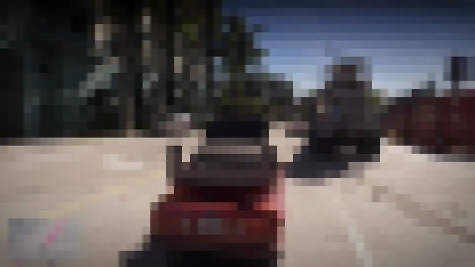
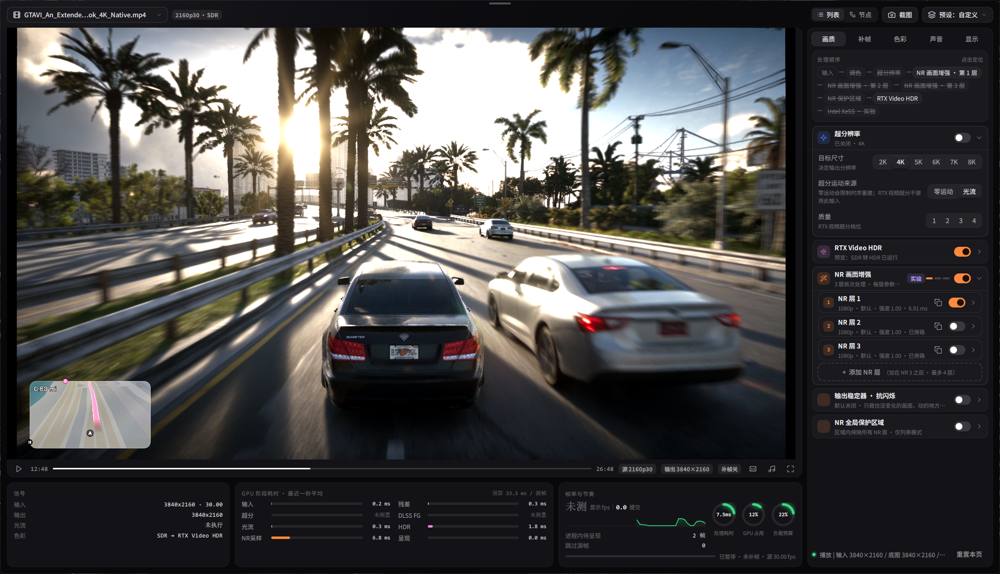
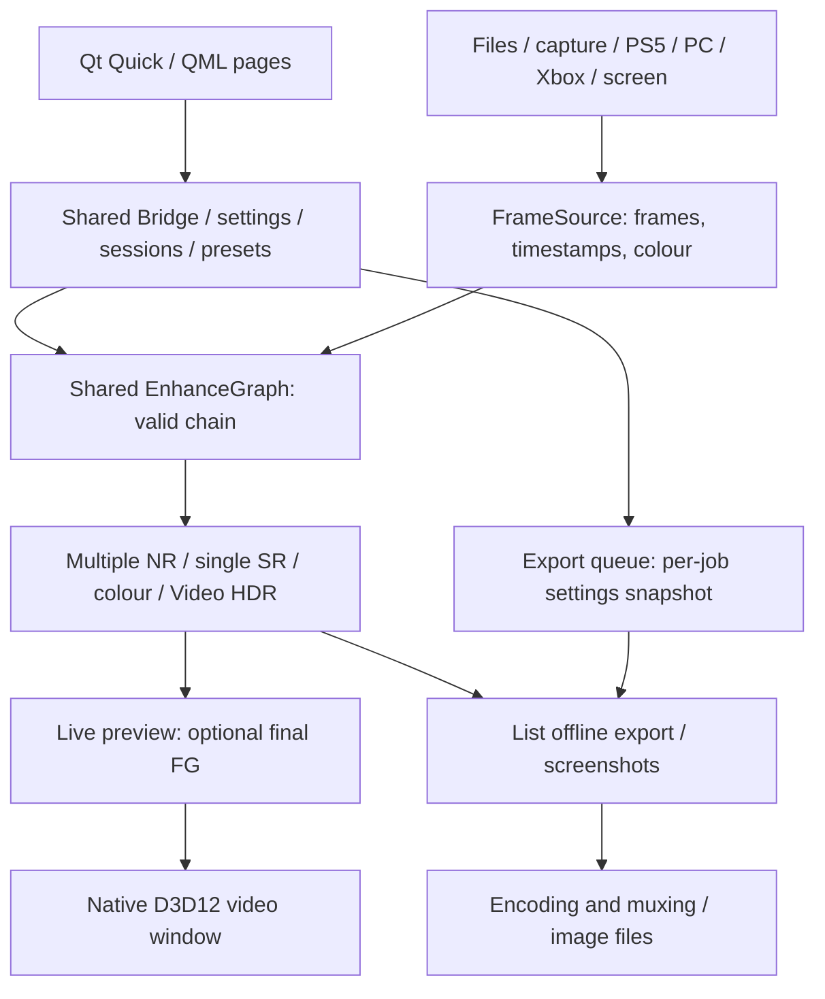

# Veyra

### Real-time GPU Video Enhancement for Windows

**Super Resolution · Denoising · HDR · Frame Generation · Capture · PS5 / Xbox / PC Streaming**

Turn local video, capture cards and game streaming into one real-time GPU enhancement pipeline.

 

 

**13K+ application downloads in the first month**

 

[**⬇ Download Latest Release**](https://github.com/Likely7/Veyra-NRVideo/releases/latest)
&nbsp;&nbsp;·&nbsp;&nbsp;
[**🇨🇳 简体中文**](README_CN.md)
&nbsp;&nbsp;·&nbsp;&nbsp;
[**🐛 Report an Issue**](https://github.com/Likely7/Veyra-NRVideo/issues)

 

  

<i>One engine. Any source. Real-time enhancement.</i>

 

  

 

<h2 align="center">⭐ Star History</h2>

  

  Open source · GPL-3.0 · Windows 11 · C++ · DirectX 12 · NVIDIA & AMD

---

**2.1.0 release, 2026-10-19:** AMD NR0.44 Small/Original models, independent anti-aliasing,468-point face beauty/restoration, capture format discovery/selection fixes, networking, AVerMedia audio and fullscreen/window capture improvements. [Full update report](docs/RELEASE_NOTES_2.1.0.md).

**New-effect cost examples:** RTX5070 standard4K anti-aliasing fixtures: FXAA~0.15ms, SMAA/MLAA~0.30ms. Final single-face mesh beauty:1080p~0.93ms,4K~1.42ms. Costs vary with content/hardware; no local AMD speedup percentage was measured. [Conditions and limits](docs/RELEASE_NOTES_2.1.0.md).

**[Veyra knowledge base](https://qcnv4i7tnd7l.feishu.cn/wiki/space/7688258025282358221?ccm_open_type=lark_wiki_spaceLink&open_tab_from=wiki_home)** — community guidance compiled from four group chats, covering software setup, common problems and capture cards.

## Highlights

**2.0.4 NR controls:** each NR layer's **Enhancement delta → Total strength** now reaches 5. **Picture control** defaults off; enable it and select Automatic or Manual. Automatic values now adapt separately to styles 0/1/2, with an amount slider (0 retains raw strength, 1 applies full correction). The nine manual controls cover hue, chroma, neutral tint, source color retention, lightness retention, shadows, highlights, local compression and temporal stability. **Use this style’s automatic values** provides a manual starting point. Switching modes keeps manual values; turning control off preserves the original residual algorithm. Five extrapolates one inference's residual, and protection reduces the corresponding changes; it cannot promise full gain five with no artifacts on every video. Presets, List/Node sessions, PNGs and video exports share the settings. [Local validation and known limits](docs/NR_STRENGTH_PROTECTION_EXECUTION_2026-10-05.md).

- **Rebuilt interface:** Home, Cinema, Professional List, Nodes, Colour, Export and Settings; Simplified/Traditional Chinese, English and Japanese.
- **Node editing and layered NR:** executable connections, independent NR/colour parameters, separate List/Node configurations, sessions and presets.
- **PC / Xbox streaming:** Moonlight/Sunshine-compatible PC streaming and unofficial experimental Xbox support, alongside PS5, capture cards and screen capture.
- **New export workflow:** editable ordered queue, trimming, MP4/MKV, multiple audio/embedded subtitle tracks, cancellation/retry and completion sound.
- **Enhancement and compatibility:** SF310.9.16 performance/legacy models, NVIDIA original for RTX50 and AMD lmxxf, DLSS/XeSS/FSR options, capture improvements and a persistent OBS Game Capture switch with restart confirmation. Full details are in the Release.

## New in 2.1.0

- **AMD NR0.44:** RX9000 Small/Original models via the per-layer performance switch(default on), saved in presets/sessions/export; explicit asset errors, no new RX6000/7000 support.
- **Anti-aliasing:** independent FXAA/SMAA/MLAA, List/Nodes, quality/strength controls, HDR and List export; experimental temporal SMAA defaults off.
- **Beauty and original-face restoration:** separate switches, up to six layers,468-point contours, eye/brow/lip exclusion, per-frame detection and smoothing; restoration mixes the pre-effect source back into faces.
- **Capture modes:** native enumeration fallback, driver ranges/steps/custom-size checks, searchable legacy list, exact rate/pixel-format matching, explicit substitution rejection, saved/resumed capture settings.
- **Network and AVerMedia audio:** shared buffering/reconnect, slow-server buffering status, HLS/interlaced damage handling, throttled subtitle scanning; vendor multichannel audio, non-PCM confirmation, complete-payload decode and bounded recovery.
- **Other fixes:** game-mode handoff/hotkeys/scaling/static resize, fullscreen transport/cursor, disabled-node order and export protocol consistency, home/sponsor page, corrected Bilibili profile and complete new translations.

[Complete2.0.9→2.1.0 update, instructions and validation limits](docs/RELEASE_NOTES_2.1.0.md). The exact user-tested packages are promoted without rebuilding/repacking; internal2.1.0-test labels/manifests remain, PE2.1.0.0.

## Install and upgrade

Download **Veyra-2.1.0-NVIDIA-win64-portable.zip** or **Veyra-2.1.0-AMD-win64-portable.zip** for Veyra's active GPU. Extract with Windows or 7-Zip into a new writable folder and run **veyra_qml_ui.exe**. You need one GPU package to run the application; source assets are only for rebuilding. Windows 11 x64 and DirectX 12 are required; Qt and approved runtimes are included, while GPU/capture drivers are installed separately. Backend hardware requirements vary; most local tests used an RTX 5070.

Start with effects off, check picture/sound, then enable effects individually. High resolution, layered NR and frame generation increase GPU/VRAM requirements.

**The 1.4.4 UI guide is obsolete.** Version 2.0 uses separate settings. Retain the old version for rollback; do not overwrite the new package with old `veyra.ini`, an entire `runtime_local` folder or mixed DLLs.

## Using 2.0

### Sources and pages

Home offers files, capture card, PS5, PC, Xbox and screen capture. Files/images can also be dropped into the window. Move to the bottom edge to reveal navigation between Home, Cinema, Professional, Colour, Export and Settings.

- Cinema prioritises the picture with a floating source/transport/audio/fullscreen bar, optionally hidden in settings.
- Professional List has Picture, Frame generation, Colour, Sound and Display tabs. The order strip locates effects; bottom panels report source/output, GPU stage time and load.
- Click a file's picture to pause/resume; left/right arrows seek five seconds. Double-click or use the fullscreen button. The fullscreen top-edge bar switches Cinema/Professional; **Home** opens quick controls in fullscreen List mode, **Ctrl+L** locks controls. Shortcuts are configurable.
- Use Screenshot and the preset menu to save pictures and personal settings. No imposed built-in quality presets.

### List mode

The NR version selector offers RTX20–50 · SF310.9.16, RTX50 · NVIDIA original and RX9000 · lmxxf (experimental) in both List and Node mode. SF defaults to performance modelB; disable Use performance model for legacyA. The control is disabled for NVIDIA original; AMD0.44 selects Small when enabled(default) and Original when disabled. Model selection is saved per layer. Lecram/oldSF-v2 settings migrate to SF. Unsupported versions remain visible but gray; switching supported versions updates the entire NR chain. AMD NR requires driver HIP 7. Video export uses at most internal 1080p inference and composites to the original output size; this is not native 4K NR and actual AMD offline encoding still needs hardware retesting. Image exports retain the native model pixel budget; HDR NR is unavailable. See [current runtime identities](docs/BUILD_2.1.0.md).

Select List at the top of Professional. Enable SR, NR or RTX Video HDR as needed. Up to four NR layers have independent internal resolution, strength and parameters. The master switch disables all layers and restores their previous enabled states.

List mode's global NR protection region excludes every NR layer inside it while retaining non-NR effects, useful for HUDs/subtitles. Colour controls include basic adjustments, curves, mixer, wheels, LUTs and colour presets.

Choose a supported FG backend/multiplier and check cadence, display sync, low-queue mode and output cap. Original/enhanced comparison temporarily pauses FG; leaving it resumes FG. Submitted FPS is not physical display FPS or end-to-end latency.

### Node mode — build a processing chain

Select Nodes at the top of Professional. This is an executable chain editor:

1. Keep a valid connected path from input to output. Right-click blank canvas or choose Add node.
2. Drag an output port to an input port, or click the two ports in order. Drop a node on a wire to insert; drag it away or release with **Alt** held to disconnect.
3. Edit parameters inside nodes. NR/colour nodes have independent settings and supported positions before/after SR. Right-click to delete, duplicate or reset. A duplicate is an independent **disconnected copy** until connected.
4. **Middle-drag to pan, wheel to zoom.** Fit/auto-layout organise the graph. “Draft not running” means invalid/disconnected edits, not that every visible node executes.
5. Optical flow is shared after input; SR is a single instance. RTX Video HDR stays before final FG; select one DLSS/XeSS/FSR backend. This is not an arbitrary branching/mixing graph.
6. List and Node settings, presets and sessions are separate. Returning to List restores its settings and retains the node graph. Switching rebuilds processing and may briefly pause the picture.

**2.0.8 Node mode does not support offline export or List mode's global NR protection region.** Switch to List and verify its effects before exporting; graphs are not silently converted.

### Capture and streaming

| Source | Setup |
|---|---|
| Capture card | Select device, resolution, rate, then a supported pixel format and audio input. Close competing apps. Match PQ/HLG/709 and Limited/Full to the signal. Magewell Pro Capture has a dedicated low-latency option. |
| PS5 | Enable Remote Play, discover/enter IP, use PSN Account ID and the console's eight-digit pairing code; reconnect saved hosts. |
| PC | Install/configure Sunshine yourself; discover/add the host, PIN-pair, select app/desktop and connect. Sunshine is not bundled. |
| Xbox | Follow device-code sign-in and select a console with remote features enabled. Unofficial/experimental; account, service and console restrictions apply. |
| Screen | Select a window/display; avoid recursively capturing Veyra itself. |

For **Screen Capture → Game mode**, choose a borderless game window or monitor. **Home** opens adjustments, Home/Esc closes them, **Ctrl+Alt+Home** exits passthrough. For **Capture card → PS5 controller control**, pair the console first; third-party streaming software can relay this PC's enhanced picture and forward remote input. Enable background controller forwarding and audio monitoring as needed. See the2.0.8 update for setup and hardware limits. Hotkeys are now customizable in Settings → Shortcuts; defaults stay Home/Ctrl+Alt+Home. Windowed game pictures follow the original visible bounds; use borderless fullscreen to fill the display.

Pausing capture/streaming freezes the preview while keeping the session, not the host game. Physical hardware, networks, HDR and controllers need individual validation.

### Export

Use **List mode**, confirm effects, then open Export. Add/reorder files, edit individual jobs, trim, select MP4/MKV and encoding quality, and keep all or selected audio/subtitle tracks.

Keep all skips unsupported tracks with a notice; explicitly choosing an incompatible track is an error. Pause/cancel/retry and completion sound are available. Defaults are VBR 8 Mbps and closing playback on export to free GPU resources, both adjustable. Live FG does not imply every backend supports offline FG; follow accepted export settings.

### OBS and settings

For OBS Game Capture, enable **Settings → General & appearance → OBS Game Capture compatibility**. Saved immediately: Yes restarts now; No applies next launch. Finish exports before restarting. Software UI rendering simplifies some shadows/blur; video enhancement stays on GPU. Game Capture targets **video**; use Windows 10 (1903+) Window Capture for the whole UI.

**Settings → General & appearance → Resume last source at startup** is opt-in. It restores the movie position or saved capture device, format, rate and audio selection. Startup page is configurable. Use the playback-speed button in Cinema or Professional for 1× / 1.5× / 2× / 3×; this does not speed up live capture/streams or offline exports.

**Monitoring compatibility** defaults to Auto: when RTSS (MSI Afterburner OSD) is running at launch, the interface uses software rendering and its OSD appears on the video only. If RTSS starts later, restart Veyra when prompted. Using RTSS with OBS Game Capture requires RTSS’s “Use Microsoft Detours API hooking” option for Veyra, or use OBS Window Capture.

**2.0.8 settings:** select a compute GPU, optionally enable RTX50 DLSS performance mode or variable refresh, and check update status. Startup checks show a temporary banner only for a newer release. Douyin Live Companion detection uses a software interface at launch and temporarily caps requested realtime GPU priority at High while it is running, restoring the requested value afterwards.

Settings include language/scale, shortcuts, monitoring GPU, audio devices and component info. Report GPU/driver, media, effects, time and `logs/veyra-qml.log`; include a crash `.dmp` if available. Review private data before sharing.

## Limitations

RTSS compatibility was verified locally with RTSS 7.3.7 on an RTX 5070; GamePP and other overlay/hardware combinations remain unverified. Real-console Xbox long runs and console/VRR capture still need field retesting. RTX 30/40 community NR/FG, FSR 4 ML hardware, some NR TDR/VRAM-growth reports and cross-device streaming retain unresolved/unverified cases. See the Release. Community runtimes are not vendor certification or a complete official DLSS 5 integration.

## Architecture

QML renders UI; native D3D12 renders video. List/Nodes share the engine, disconnected drafts do not execute, and export does not record the preview window.

## Source and build

Original code: GPL-3.0. The combined Chiaki streaming application is also subject to AGPL-3.0 and its OpenSSL exception (licenses/remoteplay). [Third-party notices](THIRD_PARTY_NOTICES.md), [2.1.0 build/source](docs/BUILD_2.1.0.md). Source Git excludes proprietary runtimes/models. Release manifests audit publisher files, not hash-lock user DLL replacements.

## Support

  
  &nbsp;&nbsp;
  

  
  &nbsp;&nbsp;&nbsp;&nbsp;
  

Left: optional donation, no feature restrictions. Right: community group; QR valid **before 2026-10-26** as shown. Check repository updates after expiry.
