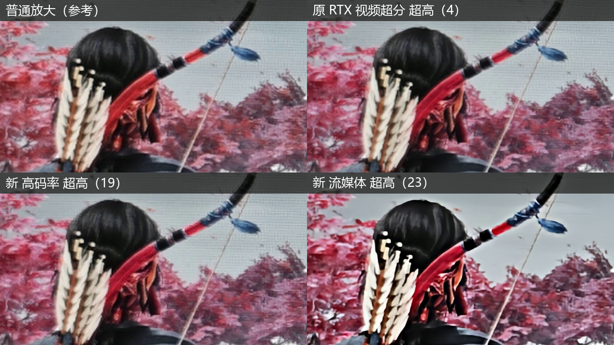

# Veyra 2.1.3｜三类 RTX 视频超分、NR 网状调节与兼容修复

本次汇总 **2.1.2 正式版之后** Claude 与 Codex 已合入主线的功能与修复。按显卡下载 NVIDIA 或 AMD 完整免安装包；普通使用无需下载源码。

## 1. RTX 视频超分：三个版本、独立档位

- **标准**：保留原 RTX 视频超分，支持放大及同尺寸修复。
- **高码率**：新增高码率模型，作为另一种细节重建选择。
- **流媒体**：新增流媒体模型，提供针对压缩视频的另一种处理风格。
- 数字档位改为 **低／中／高／超高**；标准、高码率各四档，流媒体提供 **中／超高**。三版本之间切换尽量保留对应档位。
- 基础超分与第二次超分默认均为 **中档**；从 DLSS／FSR 首次切入 RTX 版本、尚无旧档位时也从中档开始。已有明确保存的选择和预设保持。
- 高码率、流媒体用于放大；输入已经达到目标尺寸时不会运行，同尺寸修复请选择标准版本。流媒体需要 RTX 30 或更新显卡，功能是否可用以实际设备和运行组件为准。

### 新旧超分对比

原图由用户提供，未经重绘。左上普通放大作参考；右上原 RTX 视频超分超高（4）；左下新高码率超高（19）；右下新流媒体超高（23）。括号内是模型模式编号，**不是帧率或性能分数**。可对照箭羽、头发、弓弦与背景枝叶观察纹理和边缘的变化。不同模型处理风格不同，按片源和个人观感选择；这张静态图不代表所有素材的效果或运行速度。

## 2. 双重超分与超采样适配三个版本

- 第二次超分可独立选择标准／高码率／流媒体，以及自己的档位，允许与基础超分使用不同版本。
- 保持“基础超分 → 缩至中间尺寸 → 第二次超分”的顺序，超分卡片会显示处理尺寸与两次模型摘要。
- “超分后缩回到”同样支持三个版本，可将超分结果缩回选定尺寸。
- 设置、预设和重启恢复统一保存模型选择；修正更改默认档位后预设格式判断仍写死旧默认值的问题。

## 3. NR 参数：组内网状／列表切换

- 在 **增强变化量** 和 **画面调控的手动调节** 内，各自选择“网状”或“列表”，两组可以使用不同调节方式。
- 增强变化量使用四轴网状调节，**总变化强度仍为滑条**。
- 手动画面调控完整覆盖九项：**色相保护、色度保护、中性色保护、原图色彩保留、亮度保持、暗部保护、高光保护、局部压缩、时域稳定**。
- 网状与列表共用同一组参数，切换不清零、不另存一套；保留数值调节、恢复默认及预设保存能力。
- 自动／手动切换保留手动参数与所选视图；NR 模型、内部处理分辨率及其他设置仍在原区域。

## 4. RTX 30 VFG 与 RX 7000 NR

- 增加 **RTX 30 系 VFG 实验兼容路径**，复用现有运行组件；RTX 40／50 继续使用原生路径。界面保留实验标识，实际可用性与性能取决于显卡和驱动。
- 修正 **RX 7000 核显＋独显环境**的设备身份匹配：NVAPI LUID 跟随当前计算上下文，避免错误识别成另一块显卡。
- NR worker 在初始化 HIP 前按目标显卡选择设备，避免独显权重分配使用核显流；尊重外部已有的设备可见性设置。
- 补充 worker 初始化阶段、标准错误与异常诊断，便于定位设备创建失败。AMD 包已包含更新后的开源 NVAPI 与 worker，保留原模型身份和许可证。

## 5. 播放、导出与界面修复

- **全屏进度条**：修复拖动过程中全屏控制条状态变化导致拖动被取消；取消操作时正确清理待跳转状态。
- **NVENC 导出跳转**：H.264／HEVC 显式同步 IDR 周期与现有 GOP，恢复周期随机访问帧和 MP4 跳转索引。不会把普通 I 帧一律标成安全关键帧。
- **菜单文字抖动**：修正默认软件绘制下弹簧动画到达终点后的文字整像素回跳，保留原动画风格与 GPU 绘制路径。
- **英伟达低延迟**：高负载警告改成红字，**仅选中“开＋增强”时出现**，“关”和普通“开”时隐藏。高负载可以优先使用普通“开”，按自身设备观察效果。

## 6. 验证数据

- 最终完整软件 QtQuick 回归：**173 项通过、0 失败、0 跳过**；低延迟提示 GPU 绘制专项 **6 项通过**。
- 实际程序检查新默认、列表／节点中的提示切换、保存设置及重启恢复。
- 主线整合验证：**7 组超分及双重组合，每组 60 帧，共 420 帧对齐检查通过**。
- H.264／HEVC 各 **270 帧**导出，周期 IDR 位于 **0／120／240**，MP4 索引为 **1／121／241**；专门修复验收覆盖 **14 组导出与 28 次跳转**。
- NVIDIA／AMD 两个最终测试包均完成逐文件 SHA256／ZIP 校验、独立解压、最小 PATH 启动播放。软件验证主要在 RTX 5070 上完成；以上数字是相应用例的验证结果，不是所有显卡的性能承诺。

## 升级并保留设置

1. 下载匹配 Veyra 实际使用显卡的包，**推荐完整解压到新的可写目录**。
2. 完全退出旧版和新版。默认便携数据在旧版 `runtime_local/user-data-2.0.0`，复制到新版对应位置；自定义 LUT 另复制 `runtime_local/luts`。若改过数据目录，以软件“设置 → 关于”显示的实际路径为准。
3. 启动新版，检查预设、片源与模型选择。保留旧目录，确认新版本正常后再自行整理。
4. 退出后，同显卡类型的包可以覆盖解压，但容易留下旧组件；新目录迁移更清楚。**不要用整份旧 runtime 或旧 DLL 覆盖新版组件，也不要混用 NVIDIA／AMD 包。**

新安装效果默认关闭；升级保留已有明确保存的设置，默认中档不会强制覆盖你的选择。

## 下载、源码与组件

- NVIDIA／AMD 完整运行包在本页 Assets；每个包携带逐文件清单、组件来源与许可证。`SHA256SUMS.txt` 提供下载校验值。
- [应用及 RX 7000 网络对应源码](https://github.com/Likely7/Veyra-NRVideo/releases/tag/v2.1.3-sources)；[构建和固定依赖源码](https://github.com/Likely7/Veyra-NRVideo/blob/v2.1.3/docs/BUILD_2.1.3.md)。源码与运行组件分开发布。
- NR、RTX30 VFG 及相应社区运行组件保留实验性质，组件版本、来源、签名状态和 SHA256 见包内 manifest；不代表 NVIDIA 官方认证或合作。

## English summary

Since 2.1.2: three RTX Video SR families with medium defaults; independently selectable second-pass models; inline NR web/list editing with all nine manual correction controls; experimental RTX30 VFG compatibility; RX7000 multi-GPU identity/HIP selection repairs; fullscreen seeking, periodic NVENC IDR/seek indexes and software-rendered menu text fixes. Boost warnings appear in red only when On + Boost is selected. Existing explicit settings are preserved. Extract into a fresh directory and migrate only your user-data/LUT folders after exiting both versions. The supplied comparison shows model modes, not performance measurements.

## 支持与反馈 / Support & feedback

  
  &nbsp;&nbsp;
  

  
  &nbsp;&nbsp;&nbsp;&nbsp;
  

左：微信赞助（自愿，不影响功能）；右：交流群 8。群码按图片标注于 **2026-11-09 前**有效，过期请查看仓库更新。

Left: optional donation; right: community group 8. QR valid before 2026-11-09.

[Veyra 软件知识库 / Knowledge base](https://qcnv4i7tnd7l.feishu.cn/wiki/space/7688258025282358221?ccm_open_type=lark_wiki_spaceLink&open_tab_from=wiki_home)：四个群聊汇总的使用文档，涵盖软件与采集卡常见问题。

