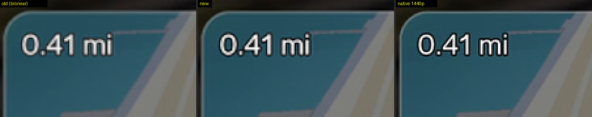
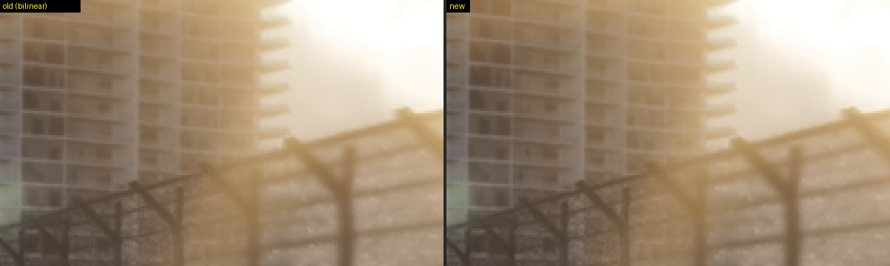

# Veyra 2.2.0

Windows 安装器、实时字幕翻译、虚拟摄像机、全屏缩放，以及从 2.1.9 以来的采集、串流、录制和导出修复。

## 下载与升级 / Download and upgrade

| Veyra 使用的显卡 / GPU | 安装器 / Setup | 便携版 / Portable |
| --- | --- | --- |
| NVIDIA | [NVIDIA Setup EXE](https://github.com/Likely7/Veyra-NRVideo/releases/download/v2.2.0/Veyra-2.2.0-NVIDIA-win64-setup.exe) | [NVIDIA ZIP](https://github.com/Likely7/Veyra-NRVideo/releases/download/v2.2.0/Veyra-2.2.0-NVIDIA-win64-portable.zip) |
| AMD | [AMD Setup EXE](https://github.com/Likely7/Veyra-NRVideo/releases/download/v2.2.0/Veyra-2.2.0-AMD-win64-setup.exe) | [AMD ZIP](https://github.com/Likely7/Veyra-NRVideo/releases/download/v2.2.0/Veyra-2.2.0-AMD-win64-portable.zip) |

- Windows 11 x64、DirectX 12。选 Veyra 实际使用的 GPU 的包。安装器可选择路径和桌面快捷方式，开始菜单和 Windows「已安装的应用」提供卸载入口。便携版解压到新建的可写目录，运行根目录的 **Veyra.exe**。
- 从旧便携版升级时，关闭旧版后按需复制 `runtime_local/user-data-2.0.0` 和 `runtime_local/luts` 到新目录的 `runtime_local`。同分版安装器可在原路径覆盖安装。已装 2.2.0 测试版的用户请用本页正式安装器覆盖一次，以取得内置发行公钥。
- 「设置 → 关于 → 检查更新」支持验证并下载之后的稳定版，正常退出后应用，启动失败时可回退。下载线路可选 GitHub、GH-Proxy 和 GHFast。镜像失败时重试直连，更新清单使用 Ed25519 签名，程序另外核对 ZIP 的包型、大小和 SHA-256。
- 这次 Windows 安装器尚未做 Authenticode 发布者签名。可按 [SHA256SUMS.txt](https://github.com/Likely7/Veyra-NRVideo/releases/download/v2.2.0/SHA256SUMS.txt) 核对下载文件。

Use the package for the GPU selected by Veyra. Run Setup or extract the portable ZIP into a writable folder and run **Veyra.exe**. To carry settings forward from the old portable layout, copy the data and LUT folders above after closing Veyra. Settings → About offers signed updates for subsequent releases. The Windows installer is Authenticode-unsigned. See the checksums above.

## 完整更新

### 显示、画质与补帧

- 全来源和大图预览启用精细送显缩放。放大使用有界三次插值，缩小时按比例扩大取样范围，减少细线和 HUD 的锯齿及闪烁。原始像素的对齐 1:1 路径保持逐像素输出，HDR 高光旁做防振铃处理。可在「专业模式 → 显示」切换画面比例对照。
- 支持选用 HUD 自动锁定、帧节奏修复和自适应补帧倍率。HUD 锁定适用于图内生成帧，XeSS 的内部呈现路径独立。自适应倍率以所选倍率为上限，使用内容帧率和显示目标调整。修复自动倍率在去重测量完成之前过早降档、输出上限计算及 RTX 30 的 CUDA 缓存问题。
- 自动去重按实际内容帧节奏工作，改善变节拍输入。60→30 下低于 30 FPS 时跳过可确认的重复画面，保留原时间戳；2X 生成帧的等待按实际刷新周期调度，给原帧留出呈现窗口。参见 [#156](https://github.com/Likely7/Veyra-NRVideo/pull/156) 和 [#126](https://github.com/Likely7/Veyra-NRVideo/issues/126)。
- 修正部分 FSR 初始化失败及 XeSS 重建资源的稳定性，并处理 Ada VFG 中档的异步失败和等待释放。原报告的显卡与驱动组合仍需复测。参见 [#164](https://github.com/Likely7/Veyra-NRVideo/issues/164)、[#169](https://github.com/Likely7/Veyra-NRVideo/issues/169)、[#145](https://github.com/Likely7/Veyra-NRVideo/issues/145)。
- 修复 PS5 SDR 暗部压暗。SDR 保留码值，HDR 请求回退到 8 位时按 SDR 处理，10 位 PQ 继续走 HDR。恢复 HDR10 静态元数据的发送和清除。HDR 曲线忽略不可信的自动峰值报告，手动峰值优先。参见 [#59](https://github.com/Likely7/Veyra-NRVideo/pull/59)。
- Dolby Vision 增加 P5/P7 RPU、EL 配对与合成、动态亮度跟随。P8.4 按 HLG 基础层处理误标 PQ 的流。细化 HEVC NAL 边界检查、AV1 硬解与软件回退，以及 NV12/P010 解码表面识别。参见 [#136](https://github.com/Likely7/Veyra-NRVideo/pull/136)、[#166](https://github.com/Likely7/Veyra-NRVideo/pull/166)、[#184](https://github.com/Likely7/Veyra-NRVideo/pull/184)。
- SDR 视频截图保留画面色彩并输出不透明的 PNG，透明静态图片和 HDR 截图保持各自的格式约定。修复 NR 模块加载时缺少导入名表的兼容性和卸载时的关闭顺序。参见 [#99](https://github.com/Likely7/Veyra-NRVideo/pull/99)、[#190](https://github.com/Likely7/Veyra-NRVideo/pull/190)、[#194](https://github.com/Likely7/Veyra-NRVideo/pull/194)。

### 采集、音频与直播

- DirectShow 跳过空压缩视频样本。Elgato 4K X 支持自动识别 HDR 和相应色彩信息，保留手动色彩选项。美乐威低延迟在两块缓冲之间衔接 DMA 和交帧，持续缺帧时自动回到普通采集。参见 [#121](https://github.com/Likely7/Veyra-NRVideo/issues/121)、[#127](https://github.com/Likely7/Veyra-NRVideo/pull/127)。
- 修复采集音频启动和重锚时的尖峰与时钟异常，关闭本机监听仍可录制采集声音。播放音量可在 0–300% 调整，旧音量配置兼容，增益变化平滑并限制峰值。参见 [#150](https://github.com/Likely7/Veyra-NRVideo/issues/150)、[#170](https://github.com/Likely7/Veyra-NRVideo/issues/170)、[#75](https://github.com/Likely7/Veyra-NRVideo/pull/75)。
- 屏幕和窗口捕获可预览并拖拽裁切。录制可按时长、体积或先达到的条件在关键帧处分段，各段独立播放。NVIDIA NVENC 支持可选的二次编码与心理视觉调优。参见 [#131](https://github.com/Likely7/Veyra-NRVideo/issues/131)、[#120](https://github.com/Likely7/Veyra-NRVideo/issues/120)。
- 「播放地址」支持 RTP、UDP MPEG-TS 组播。网络直播时移支持 1、2、5 分钟缓存，在进度条回看或返回直播，压缩包缓冲上限 256 MiB。保留通用浏览器直链桥接，移除站点专属功能。参见 [#157](https://github.com/Likely7/Veyra-NRVideo/issues/157)、[#49](https://github.com/Likely7/Veyra-NRVideo/issues/49)。

### OBS 与虚拟摄像机

- 录制按钮旁打开虚拟摄像机，OBS 的「视频采集设备」选择 **Veyra Virtual Camera**。输出是处理后的完整画面，分辨率独立于 Veyra 窗口，可自动跟随消费者帧率或设 30/60/120 上限。音频在直播软件单独采集，HDR 摄像机输出在此处转 SDR。
- 有序共享队列和对齐 OBS 的送帧时钟减少重复与跳帧。修复暂停消费时生产队列关闭、再次打开的兼容性。若用管理员 OBS 且已安装旧系统组件，先在 Veyra「设置 → 直播软件兼容组件」点「更新组件」，再重启 OBS。参见 [#188](https://github.com/Likely7/Veyra-NRVideo/pull/188)。
- 新增独立 Linux OBS 滤镜源码，提供 3D LUT、曝光／对比／饱和、FXAA 和锐化。安装与构建见 [OBS 滤镜文档](https://github.com/Likely7/Veyra-NRVideo/blob/v2.2.0/docs/OBS_FILTER.md)。参见 [#96](https://github.com/Likely7/Veyra-NRVideo/pull/96)。

### 串流、解码与导出

- PS5 修复入队帧过期竞争、解码积压下的控制器节奏、快速组合键及触摸历史、L2/R2 松键遗漏。同步支持的 DualSense 灯条和玩家灯，修正扳机反馈协商。PS5 队列保持原低延迟上限，同时增加恢复和峰值深度统计。参见 [#133](https://github.com/Likely7/Veyra-NRVideo/pull/133)、[#161](https://github.com/Likely7/Veyra-NRVideo/pull/161)、[#168](https://github.com/Likely7/Veyra-NRVideo/pull/168)、[#173](https://github.com/Likely7/Veyra-NRVideo/pull/173)、[#178](https://github.com/Likely7/Veyra-NRVideo/pull/178)、[#179](https://github.com/Likely7/Veyra-NRVideo/pull/179)。
- Xbox 串流跳过损坏 H.264 帧并从关键帧恢复，可手动选软件解码。音频以展开后的 RTP 时间戳对齐，掉包时减少累计漂移。Moonlight 校验配对证书后再更换已配对主机地址，限制分块响应的接收缓冲。参见 [#140](https://github.com/Likely7/Veyra-NRVideo/pull/140)、[#183](https://github.com/Likely7/Veyra-NRVideo/pull/183)、[#195](https://github.com/Likely7/Veyra-NRVideo/pull/195)、[#197](https://github.com/Likely7/Veyra-NRVideo/pull/197)。
- 硬解中途回退时保留定位和历史重置标记，跳过已输出的帧。导出时间戳倒退时重建连续时间线，分段合并成功落盘后清理旧段，保存失败保留可恢复文件。导出进程在拒绝任务时显示实际原因。参见 [#187](https://github.com/Likely7/Veyra-NRVideo/pull/187)、[#189](https://github.com/Likely7/Veyra-NRVideo/pull/189)、[#192](https://github.com/Likely7/Veyra-NRVideo/pull/192)、[#193](https://github.com/Likely7/Veyra-NRVideo/pull/193)。
- 字幕自动对齐遇音频格式切换时重建重采样器，多个 ASS 轨共享 MKV 内嵌字体。已有设置、预设和播放列表读写失败时保留原文件。中文等本地化 MSVC 环境下 Ninja 继续跟踪头文件依赖。参见 [#167](https://github.com/Likely7/Veyra-NRVideo/pull/167)、[#185](https://github.com/Likely7/Veyra-NRVideo/pull/185)、[#186](https://github.com/Likely7/Veyra-NRVideo/pull/186)、[#191](https://github.com/Likely7/Veyra-NRVideo/pull/191)、[#196](https://github.com/Likely7/Veyra-NRVideo/pull/196)。

### 实时翻译和界面

- 「设置 → 播放 → 实时翻译设置…」可用 Windows 11 实时字幕识别正在播放的音频，并在预览中显示译文。默认关闭。首次打开 Windows 实时字幕时选择原文语音包。翻译引擎可选本机 Qwen2.5 1.5B Q4、自定义 OpenAI 兼容 API 或 MyMemory。本机模型与 CPU 运行库约 **1.14 GB**，在面板下载并校验 SHA-256。API Key 仅用于本次运行，启用云端服务才发送字幕文本。参见 [#203](https://github.com/Likely7/Veyra-NRVideo/pull/203)。
- 首页新手引导逐步指出片源、采集格式、超分、NR、补帧及自动去重。采集卡页面顶部可打开内置格式与补帧帮助。支持 HDR 的采集模式选 P010 和 HDR PQ，SDR 信号按 SDR 配置。首页启动采集卡默认进入专业模式。
- 全屏按 Home 打开完整专业面板和阶段耗时。修复底栏仪表宽度、VFG 控件换行、窄窗口和高 DPI 下的操作区、对话框及长译文排版。新增韩语、法语、德语、西班牙语、巴西葡萄牙语和俄语界面，补齐状态和错误翻译。

## Scaling comparisons / 画质对比

同一批游戏画面在 RTX 5070 离屏运行实际送显着色器后裁切。1080p → 1440p 图从左到右为旧双线性、新精细缩放和 1440p 参考。缩小图的左侧为旧版，右侧为新版。

**1080p → 1440p · HUD 字样 / HUD text**

**1440p → 1080p · 细线 / Fine edges**

更多同批裁切 / More crops · [车牌 / Plate](https://raw.githubusercontent.com/Likely7/Veyra-NRVideo/v2.2.0/docs/images/2.2.0/crop-up1440-plate.png) · [建筑 / Buildings](https://raw.githubusercontent.com/Likely7/Veyra-NRVideo/v2.2.0/docs/images/2.2.0/crop-up1440-bldg.png) · [缩小 HUD / Downscaled HUD](https://raw.githubusercontent.com/Likely7/Veyra-NRVideo/v2.2.0/docs/images/2.2.0/crop-down1080-hud.png)

## 实测摘录 / Validation

| 检查 / Test | 结果 / Result |
| --- | --- |
| 送显缩放 / Presentation scaling | 同一游戏样帧 1080p → 1440p，对 1440p 参考的 PSNR 为 **44.62 → 46.91 dB**。RTX 5070 的 4K → 1440p GPU 送显开销 **0.044 → 0.295 ms**，不含屏幕扫描和采集。 |
| 采集回放 / Capture replay | 59.94 FPS 抖动输入，60→30 + VFG 2X 约 70 秒。软件提交 2,097 真实帧、2,096 生成帧，生成无效 0。 |
| 虚拟摄像机 / Virtual camera | 1080p60 OBS 通道，30 FPS 移动纹理用 4X 后采集为 60 FPS。旧方案 443 步中重复 53、跳帧 54；有序送帧后 5 次各 443 步均匀。该测试使用非管理员 OBS。 |
| PS5 SDR / Color fixtures | 在 H.264、HEVC 测试位流及 GPU 色彩对照中，四组 SDR 最大码值误差 **13/255 → ≤1/255**。 |
| 录制分段 / Segmented recording | 2 秒 H.264、1 MiB HEVC 共验证 9 段可独立解码，音画起点最大相差 **20.7 ms**。 |
| 本机译文 / Local translation | 合成字幕到本机首个译文约 **1.78 秒**。耗时不含讲话、Windows 语音识别和首次下载。 |

这些数据对应各栏的测试素材与设备。未据此推算端到端屏幕延迟。美乐威 Pro Capture 改后实卡帧率、真实 PS5 同场景及其他显卡的专属路径仍待现场反馈。

## English changelog

- **Picture and frame generation.** Higher-quality fullscreen and window scaling for every source, including antialiased downscaling and HDR highlight handling. Added optional HUD locking, pacing repair and adaptive frame generation, alongside output-cap and CUDA cache fixes. Content-aware deduplication and 60→30 retain input cadence. More robust FSR initialization, XeSS resources and VFG recovery.
- **Color and decoding.** PS5 SDR preserves code values. HDR10 metadata is reapplied on swapchain changes, and the HDR curve filters untrusted display peaks. Expanded Dolby Vision handling for P5/P7 and misleading P8.4 tags. Improved HEVC length validation and AV1 hardware decode, bit depth and fallback. SDR video screenshots retain colors and use opaque PNG output. NR initialization and shutdown handle more runtime variants safely.
- **Capture and live playback.** Skips empty compressed DirectShow samples, detects HDR on Elgato 4K X, and overlaps Magewell DMA with the previous frame's delivery. Capture audio is more tolerant of clock changes, and recording can continue with monitoring muted. Added smooth volume gain up to 300%, drag-to-crop screen capture, keyframe-aligned recording splits, optional NVENC multipass and psycho-visual tuning, RTP/UDP multicast and bounded live timeshift. Direct links continue to work through the generic browser bridge.
- **Streaming and exports.** More reliable PS5 queue expiration, fast combos, trigger releases and controller feedback. Xbox recovers damaged frames from a keyframe and follows RTP audio timing. Moonlight revalidates previously paired hosts and bounds chunked responses. Decoder fallback preserves seek history. Export handles timestamp rollback, reports worker rejections and retains recoverable segments when finalizing fails. Subtitle resampling, shared embedded fonts, settings, presets and playlist persistence are more robust.
- **Virtual camera and OBS.** Processed full-frame output from the recording toolbar, with ordered delivery and OBS cadence alignment. Reopens consumer queues after pause. The Windows virtual camera carries video; capture audio separately. The Linux OBS filter supplies LUTs, grading, FXAA and sharpening. If an elevated OBS session uses the old system component, update it in Veyra Settings and restart OBS.
- **Live translation and UI.** Open Settings → Playback → Live Translation. Use Windows Live Captions with the spoken language selected, then choose the target and a local or online translation engine. The local 1.14 GB model and CPU runtime are an in-app download. Added onboarding, a capture-format guide, a full-screen Home panel with timing, better compact-window layout, and Korean, French, German, Spanish, Brazilian Portuguese and Russian localization. Capture opened from Home goes to the professional view.
- **Distribution.** Per-GPU setup and portable packages, signed stable update manifests and mirror selection. Localized MSVC builds preserve Ninja's include dependencies.

[对应源码 / Corresponding sources](https://github.com/Likely7/Veyra-NRVideo/releases/tag/v2.2.0-sources) · [构建与运行组件 / Build and runtime details](https://github.com/Likely7/Veyra-NRVideo/blob/v2.2.0/docs/BUILD_2.2.0.md) · [完整提交差异 / Full commit history](https://github.com/Likely7/Veyra-NRVideo/compare/v2.1.9...v2.2.0)
