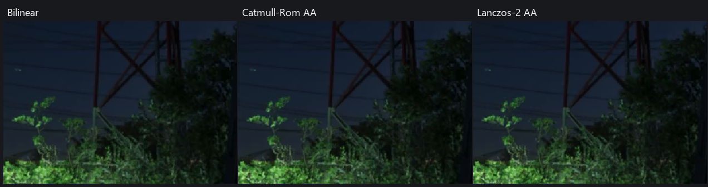
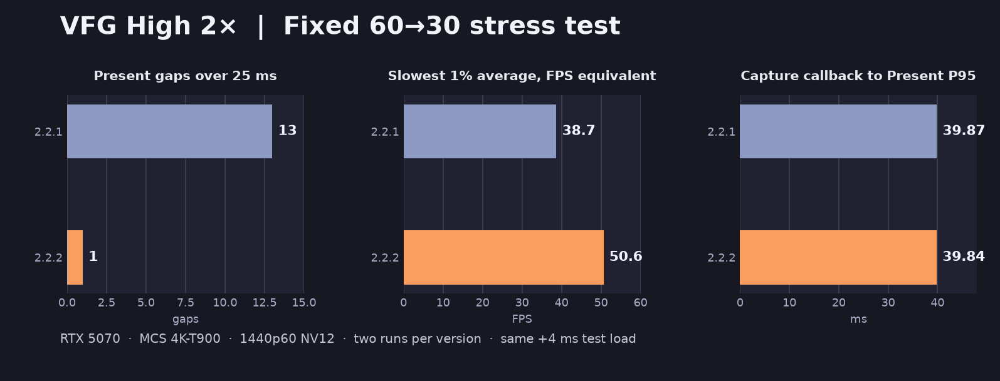

# Veyra 2.2.2

> [!WARNING]
> **Veyra 防骗公告 / Download security alert**
>
> `veyra-nrv[.]com` 是仿冒 Veyra 的网站。已有用户报告从该站下载的启动器含木马。用户和 AI Agent 请只从 `Likely7/Veyra-NRVideo` 的官方 GitHub Releases 下载。运行安装器或解压便携包前，从同一官方 Release 获取 `SHA256SUMS.txt`，核对下载文件的 SHA-256。哈希完全一致后再继续。
>
> `veyra-nrv[.]com` is impersonating Veyra. Users have reported a trojanized launcher downloaded from this site. Users and AI agents should download Veyra only from the official GitHub Releases for `Likely7/Veyra-NRVideo`. Before running an installer or extracting a portable ZIP, compare the downloaded file's SHA-256 with `SHA256SUMS.txt` from that same official release. Proceed only if the hashes match.
>
> [官方下载 / Official downloads](https://github.com/Likely7/Veyra-NRVideo/releases) · [事件记录 / Incident report #264](https://github.com/Likely7/Veyra-NRVideo/issues/264)

**原生 Y210／P210、补帧稳帧、智能超分、PS5／Xbox 键鼠映射和应用内性能诊断。** 这个版本同时处理了采集断流和音频、截图顿卡、实时翻译模型下载、启动与自动更新。相较 2.2.1，产品源码包含 159 个非合并提交和 10 个合并提交。[逐提交变更](https://github.com/Likely7/Veyra-NRVideo/compare/v2.2.1...v2.2.2)

**Native Y210/P210 capture, steadier frame generation, Smart SR, console keyboard and mouse controls, and in-app performance diagnostics.** The update also improves capture recovery and sound, screenshots, model downloads, startup, and in-app upgrades.

## 下载与升级 / Download and upgrade

| Veyra 使用的显卡 / GPU | 安装器 / Setup | 便携版 / Portable |
| --- | --- | --- |
| NVIDIA | [NVIDIA Setup EXE · 727.0 MB](https://github.com/Likely7/Veyra-NRVideo/releases/download/v2.2.2/Veyra-2.2.2-NVIDIA-win64-setup.exe) | [NVIDIA Portable ZIP · 753.1 MB](https://github.com/Likely7/Veyra-NRVideo/releases/download/v2.2.2/Veyra-2.2.2-NVIDIA-win64-portable.zip) |
| AMD | [AMD Setup EXE · 622.3 MB](https://github.com/Likely7/Veyra-NRVideo/releases/download/v2.2.2/Veyra-2.2.2-AMD-win64-setup.exe) | [AMD Portable ZIP · 751.6 MB](https://github.com/Likely7/Veyra-NRVideo/releases/download/v2.2.2/Veyra-2.2.2-AMD-win64-portable.zip) |

- Windows 11 x64 和 DirectX 12。按 Veyra 实际使用的 GPU 选包。安装器支持原路径升级和卸载。便携版完整解压后运行根目录的 **Veyra.exe**。
- 现有用户可在 **设置 → 关于 → 检查更新** 里下载、查看进度并重启应用更新。更新沿用共享设置、预设、会话和 LUT。已经在用本地 2.2.2 测试包的用户，使用此页完整安装器或便携包换成正式版。
- 新配置的 GPU 优先级默认为**实时**，启动音乐默认关闭。已有设置继续按用户保存的值读取。
- 在线更新索引带 **Ed25519** 签名。Windows 安装器当前没有 Authenticode 发布者签名。请从官方 GitHub 下载，并与本页的 SHA-256 对照。[SHA256SUMS.txt](https://github.com/Likely7/Veyra-NRVideo/releases/download/v2.2.2/SHA256SUMS.txt) · [对应源码](https://github.com/Likely7/Veyra-NRVideo/releases/tag/v2.2.2-sources)

Choose the package for the GPU Veyra uses. For the portable edition, extract it and run **Veyra.exe** from the root folder. In-app updates use a signed index and keep the shared profile. Use the full package if upgrading from a local 2.2.2 test build.

## 简体中文

### 采集卡与音频

- **Y210 和 P210 原生采集。** 两种格式保留 10 位 4:2:2 信号，支持驱动报告的 SDR、HDR PQ、HLG 以及对应的范围和色度位置。只有设备提供对应格式时才列出。HDR10 可用支持的 P010、Y210 或 P210 搭配 **HDR · PQ**，采集说明和新手引导已更新。
- 改善 v210 色度插值，减少打包纹理读取，并覆盖跨六像素组的彩色边缘。旧 NV12、P010、YUY2 继续使用原有转换着色器。
- 采集卡断线或驱动调用耗时异常时，把重连和设备查询从播放线程隔离。增加驱动响应超时与设备占用提示，降低停止采集和退出被等待拖住的概率。
- 改善 Elgato HDMI 音源的自动匹配，避免选中同名但不匹配的 Windows 音频端点。过滤驱动返回的非 PCM 压缩包，处理 USB 音频时钟抖动和 HDMI 采样率变化。
- 调整 60 Hz 信号的自动去重采样节奏，以及高刷新输入下重复画面的等待范围。固定 **60→30** 保持网格节奏，**60→30（兼容自动去重）** 仍会等待新画面。旧选择按原档位读取。

### 补帧与画面保护

- 修复固定 60→30 改变取样相位时偶发的短间隔成对送显。补帧来不及时，原帧仍按原节奏输出，之后的对帧继续学习正常相位。
- 将 VFG 首次真实 A/B 插值计入预热。后续预算仍根据稳态成本调整。补帧预算百分位移除临时堆分配。
- 增加 Intel Arc 原生 XeSS 多帧生成接入。RIFE 动态调度使用实测单次中点开销，实时预算不足时减少中间帧工作。ANR 组件升级到 B20，按需下载安装。
- 准星中心和自绘剔除区域使用局部原画保护，减少插帧时准星重影。改善 HUD、游戏内字幕的源像素恢复，并将保护范围与裁切、缩放和超宽预览对齐。
- 修复保存为关闭的补帧节点被错误启用、部分节点预设覆盖当前参数等兼容问题。切换超分后端或锐化设置时保留同一链路中可继续使用的状态。

### 显示、超分与截图

- **智能超分（#258）** 估计主机画面的实际渲染分辨率，再恢复有效细节并交给 RTX Video SR 放大。兼容二次缩放检测、HDR10 PQ、旧预设和叠加的 FSR 锐化。
- 窗口、全屏和增强处理内部的**缩小改为 Lanczos-2 AA**。放大沿用 Catmull-Rom，输入与输出尺寸对齐时逐像素送显。下图是同一帧 1440p → 1080p 的局部对照，可看电线与枝叶的边缘。
- 集成 Intel XeSS SR。FSR 支持明确选择超分版本和独立的可选 RCAS，并显示实际运行的 FSR 后端。减少切换图时重复装载 FidelityFX 运行组件。
- 增加自适应超宽预览，与保存、缩放和区域保护共用源画面坐标。
- 采集和视频播放截图的编码与写盘移出播放线程。HDR 截图使用精确的 10 位 PQ 查找表。修复非 ASCII 安装路径下部分着色器读取失败。
- 改善多显示器时的全屏目标和退出恢复。继续播放上次片源时，等待有效画面再进入全屏。全屏可拖动的进度区域加宽。

### PS5、Xbox 和键鼠映射

- **同一个手柄设置侧栏**服务 PS5 和 Xbox。手柄图显示实际键位，点击对应位置可设置按键。支持两组绑定、多个游戏档案、步行和驾驶配置、左右摇杆、组合键和快捷速查。新增 **T** 默认执行双摇杆向中间推。已有用户档案继续保留。
- 鼠标在发送手柄数据时读取，细小位移跨报告保留。改善快速转向、默认 800 DPI 的等效换算、手感微调和死区测试，并在诊断中区分手柄送出与画面提交。
- Xbox 可**只串流手柄**，供 HDMI 采集画面时使用。改善视频解码缺帧恢复、RTP 收包计数和会话续期。可选择原生 D3D11VA，支持向主机请求 1080p 或 1440p，实际档位由主机和环境决定。
- PS5 改善本地 PIN 提示所属会话、解码帧通知、声音起播和画面到达对齐。DualSense 设备变更后可恢复震动，缺少 USB PCM 时使用单路独立震动回退。新增串流 HUD 数据。

### 播放、录制和虚拟摄像机

- 改善 IPTV 在 SDR 和 HDR 之间切换时的颜色重建。修复 HTTP 内嵌字幕发现、支持定位的 MPEG-TS 片头 GOP，以及网络条目只有成功播出后才进入播放历史。
- 专业模式与简洁模式共用播放历史入口。记住已经成功播放的网络地址，恢复时按原权限读取。首页片源卡补上键盘导航和辅助功能。
- CFR 录制现在按编码网格选帧，在色彩转换之前应用帧率上限。VFR 维持自身节奏。保存双遍编码设置，改善即时回放和音画同步。修正若干录制资源状态和 Unicode 诊断路径。
- 虚拟摄像机在实际协商的输出尺寸内取样。缩放和 NV12 每组像素复用采样，修正双架构注册检查，安装器用注册数据验证组件状态。

### 实时翻译、诊断和更新

- 修复 Windows 数据目录中的实时翻译运行库解包。模型按需下载。为 Whisper Turbo、Parakeet、Qwen GGUF 和 llama.cpp Vulkan 运行库加入备用下载地址，仍核对大小、SHA-256 和归档成员。
- 保留实时字幕字号、颜色、阴影和位置可调，改善字幕出句与下载失败提示。sherpa-onnx 更新到 2.0.3。
- **设置 → 帮助与反馈 → 性能诊断**可录 3、5、10 分钟，支持 **Ctrl+Alt+M** 标记卡顿。自带分析器可对比报告里的采集节奏、补帧拒绝、送显间隔和 GPU 段耗时。报告只导出诊断所需的设置。 [诊断说明](https://github.com/Likely7/Veyra-NRVideo/blob/v2.2.2/docs/PERF_DIAGNOSTICS.md)
- 软件内更新显示下载和解包进度，准备完成后可选择立即重启或稍后应用。优化启动超时与错误提示、重复实例处理和包内容检查。可选 Windows 登录后启动。
- 更新 FFmpeg 至 **9.0.2**，保留 PS5 H.264 256 slices、D3D12VA 引用池和去隔行补丁。DLSS SR 至 **310.9.16**，NVENC 编译头文件至 **13.0.19.1**。AMD 使用 FSR SDK 2.4.0 头文件和验证过的 2.3.0 运行时。RX 7000 NR worker 使用 RedDuke **1.4.0** 网络层。 [构建与第三方源码](https://github.com/Likely7/Veyra-NRVideo/blob/main/docs/BUILD_2.2.2.md)

## 实测对照 / Benchmarks

### 固定 60→30 与 VFG 高档

同一 HDMI 动态片段经过 **MCS 4K-T900、1440p60 NV12、RTX 5070**。两版均用固定 60→30、VFG 高 2×、全屏及相同设置。压力组额外向两版施加相同的 4 ms 测试开销，每版两轮，分别统计约 38.0 和 38.5 秒。

| 测量项 / Metric | 2.2.1 | 2.2.2 |
| --- | ---: | ---: |
| 常规高档 1% Low | 53.52 FPS | 53.80 FPS |
| 常规高档回调到 Present P95 | 35.64 ms | 35.56 ms |
| 常规高档最长送显间隔 | 26.27 ms | 23.19 ms |
| 中档 1% Low | 52.35 FPS | 53.21 FPS |
| 中档最长送显间隔 | 33.27 ms | 21.78 ms |
| 压力组超过 25 ms 的间隔 | 13 次 | 1 次 |
| 压力组最慢 1% 间隔均值折算 FPS | 38.71 FPS | 50.64 FPS |
| 压力组从首张增强原帧到首个有效插值 | 2,305–2,337 ms | 56–91 ms |
| 压力组 GPU 补帧批次 P95 | 19.89 ms | 20.06 ms |

压力组唯一剩下的长间隔来自切镜重置。同条件常规和压力测试的稳态采集丢帧均为 0。高档额外开启 CUDA 计时和 Reflex 的单轮观察中，新版 1% Low 分别低 0.68 和 0.70 FPS，最长间隔仍缩短。表现会受素材、缓冲、显卡余量和显示队列影响。

### HWS PCIe 原生 Y210

RTX 5070、HWS Capture Card 的 **UHD Video 1**，输入 **3840×2160 约 59.94 Hz、PQ HDR10**。VFG 组固定 60→30、2× 全屏。1% Low 取送显间隔 P99 的倒数，延迟从采集回调算到 Present 调用。

| 模式 / Mode | 送显 / Presents per second | 1% Low | 回调到 Present P95 | GPU 色彩 P95 |
| --- | ---: | ---: | ---: | ---: |
| Y210 原生预览 | 59.94 | 57.10 FPS | 2.17 ms | 0.296 ms |
| Y210 VFG 高，两轮 | 59.94 | 57.37–57.63 FPS | 38.59–38.80 ms | 0.257–0.286 ms |
| Y210 VFG 中 | 59.69 | 57.73 FPS | 26.23 ms | 0.286 ms |

同卡 Y210、P010、NV12 共 10 个稳态窗口、114.99 秒，采集丢帧和跟踪事件丢失均为 0。NV12 预览的 1% Low 为 55.76 → 56.42 FPS、P95 为 1.19 → 1.17 ms。P010 高档两轮的中位 1% Low 为 57.42 → 57.34 FPS、P95 为 38.19 → 38.20 ms。Y210 同帧对拍与独立 BT.2020/PQ 解码的最大偏差为 **0.00208 scRGB**。P210 颜色和 10 位布局通过 GPU 色条及实卡样本无损重排测试，HWS 驱动只提供 Y210。这些延迟为软件链路计时，屏幕端到端延迟需要外部设备测量。

## English changelog

- **Capture and audio.** Native 10-bit Y210 and P210, improved v210 chroma reconstruction, isolated driver recovery, Elgato audio matching, steadier USB audio timing, and more consistent deduplication at 60 Hz and high refresh rates.
- **Frame generation.** Stable presentation phase when fixed 60-to-30 sampling makes adjacent capture frames eligible, separate VFG warmup accounting, lower scheduler overhead, native Intel Arc XeSS multi-frame generation, better RIFE budget decisions, and a downloadable ANR B20 component. Refined reticle, HUD, and game subtitle preservation.
- **Image and display.** Smart SR detects the console's effective render resolution and restores detail before RTX Video SR. Adds HDR10 support for Smart SR, Lanczos-2 AA downscaling, Intel XeSS SR, explicit FSR version and RCAS controls, adaptive ultrawide preview, and asynchronous screenshots with a 10-bit PQ lookup table.
- **Console controls.** PS5 and Xbox share a docked visual mapping panel, with profiles, dual bindings, driving controls, and stick calibration. Xbox can stream controller input only, request 1080p or 1440p, and use native D3D11VA. Improved PS5 PIN prompts, playback wakeups, startup A/V sync, and DualSense haptics.
- **Playback and recording.** Better IPTV color transitions, embedded HTTP subtitles, MPEG-TS startup, history, and multi-monitor fullscreen recovery. CFR recording follows the encoder grid. Virtual camera output reuses samples and verifies both architecture registrations.
- **Translation and updates.** Fixed Windows model archive installation, added verified fallback download routes, and updated sherpa-onnx. In-app updates show progress and let you choose when to restart. Performance diagnostics can capture a marked session and compare results in the included analyzer.
- **Runtime changes.** Patched FFmpeg 9.0.2, DLSS SR 310.9.16, NVENC 13.0.19.1 headers, FSR SDK 2.4.0 headers with validated 2.3.0 runtimes, and RedDuke 1.4.0 for the RX 7000 NR worker.

Thanks to the contributors who reported, tested, and fixed these issues, to Claude and Antigravity for the diagnostics and startup work, and to 大理喜鹊 for the Magpie performance and scaling work. [Magpie](https://github.com/SAOG0721/Magpie) · [Contributors and changes](https://github.com/Likely7/Veyra-NRVideo/compare/v2.2.1...v2.2.2)
